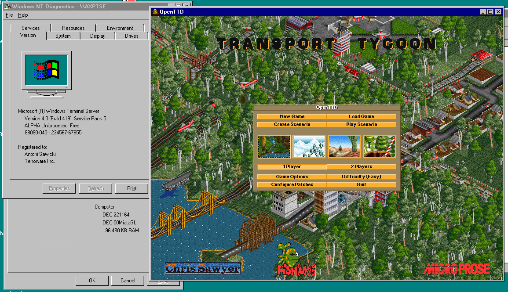

# OpenTTD for Windows NT RISC



OG port to Alpha AXP by Nitton Åttiofyra aka 1984: https://www.youtube.com/watch?v=LyKl2UVg_As

This is a continuation, to support MIPS, PowerPC, Itanium, ARM, etc.

## PINT (Windows NT on the Raspberry Pi)

The releases have `ttd-pint35-arm.exe` for PINT 3.5 and `ttd-pint40-arm.exe` for PINT 4.0.
Put it in the folder of `release.zip`, with the data. They were built with the PINT SDK in Docker
([tenox7/pint35sdk](https://hub.docker.com/r/tenox7/pint35sdk) for PINT 3.5,
[tenox7/pint40sdk](https://hub.docker.com/r/tenox7/pint40sdk) for PINT 4.0;
their page tells how to set them up once):

```
docker run --rm -v msvc-arm32:/opt/msvc -v "$PWD":/src tenox7/pint40sdk nmake
```

NT 3.5 cannot change the display mode, so on PINT 3.5 the game always runs in a window.
